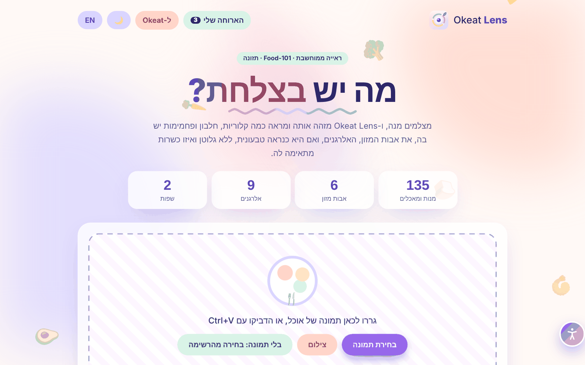
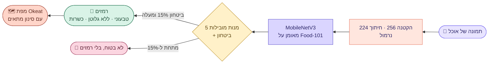

<div dir="rtl">

<p align="center">
  <a href="https://noyaadivi.github.io/okeat-lens/"></a>
</p>

<p align="center"><a href="README.md"></a></p>

<p align="center">
  <a href="https://noyaadivi.github.io/okeat-lens/"></a>
  <a href="#how-it-works"></a>
  <a href="docs/INTEGRATION.md"></a>
</p>

<p align="center">
  <a href="https://github.com/NoyaAdivi/okeat-lens/actions/workflows/tests.yml"></a>
  <a href="LICENSE"></a>
  <a href="https://github.com/NoyaAdivi/okeat-lens/commits/main"></a>
  <a href="https://github.com/NoyaAdivi/okeat-lens"></a>
</p>

<h3 align="center">מכוונים מצלמה לצלחת. רואים מה יש בה ומה אפשר לאכול.</h3>

<p align="center">
  Okeat Lens הוא מודל ראייה ממוחשבת שמזהה <b>101 מנות</b> מתמונה אחת<br>
  והופך אותן לרמזים ש-<a href="https://okeat.vercel.app">Okeat</a> מבין: טבעוני, צמחוני, ללא גלוטן וסוג כשרות.
</p>

<table align="center">
  <tr>
    <td align="center" width="25%"><a href="#the-model"><b>🍽️ 101</b></a><br><sub>מנות שהוא מזהה</sub></td>
    <td align="center" width="25%"><a href="#the-model"><b>🧠 MobileNetV3</b></a><br><sub>מאומן על Food-101</sub></td>
    <td align="center" width="25%"><a href="README.md"><b>🌍 HE · EN</b></a><br><sub>כל מנה בשתי השפות</sub></td>
    <td align="center" width="25%"><a href="https://github.com/NoyaAdivi/okeat-lens/actions/workflows/tests.yml"><b>🧪 CI</b></a><br><sub>בדיקות בכל push</sub></td>
  </tr>
  <tr valign="top">
    <td valign="top" width="33%">
      <p><b>🍽️ מה יש במנה</b></p>
      <ul>
        <li><b>קלוריות, חלבון, פחמימות, שומן</b>, סיבים, סוכר ונתרן</li>
        <li><b>גרף עוגה מונפש</b> ואחוז מהצריכה היומית</li>
        <li><b>בחירת כמות</b>: ½, 1, 1½ או 2 מנות</li>
      </ul>
    </td>
    <td valign="top" width="33%">
      <p><b>🥚 אבות המזון</b></p>
      <ul>
        <li><b>פחמימות, חלבונים, שומנים, ויטמינים, מינרלים ומים</b></li>
        <li><b>אילו ויטמינים ומינרלים</b> בולטים במנה</li>
        <li><b>צלחת מאוזנת</b> עם הצעה מה להוסיף לצד</li>
      </ul>
    </td>
    <td valign="top" width="33%">
      <p><b>✨ מה שאין באפליקציות אחרות ביחד</b></p>
      <ul>
        <li><b>9 אלרגנים</b> לכל מנה, ליד סוג הכשרות</li>
        <li><b>הארוחה שלי</b> מחברת מנות, <b>השוואה</b> בין שתי מנות</li>
        <li><b>כרטיס לשיתוף</b>, שיתוף הארוחה, 🎲 הפתעה ובחירה ידנית</li>
      </ul>
    </td>
  </tr>
</table>

<a name="highlights"></a>
<p align="center"><a href="#see-it-in-action"></a></p>

<table>
  <tr valign="top">
    <td valign="top" width="33%" dir="rtl">
      <p><b>📸 רואה מנה, יודע מה היא</b></p>
      <ul>
        <li><b>למידת העברה</b> על 101,000 תמונות אוכל</li>
        <li><b>5 ניחושים מובילים</b> עם רמת ביטחון לכל אחד</li>
        <li><b>שם בעברית ובאנגלית</b> לכל מנה</li>
        <li><b>יודע מתי הוא לא בטוח</b> ואומר את זה</li>
      </ul>
    </td>
    <td valign="top" width="33%" dir="rtl">
      <p><b>🥗 הופך אותה לרמזים תזונתיים</b></p>
      <ul>
        <li><b>טבעוני, צמחוני, ללא גלוטן</b> לכל מנה</li>
        <li><b>סוג כשרות:</b> בשרי, חלבי, פרווה או כנראה לא כשר</li>
        <li><b>כן מההתחלה:</b> רמז אף פעם לא מסומן כמאומת</li>
        <li><a href="docs/INTEGRATION.md"><b>מתחבר ל-Okeat</b></a> ופותח את המפה עם הסינון הנכון</li>
      </ul>
    </td>
    <td valign="top" width="33%" dir="rtl">
      <p><b>💛 בנוי לשימוש אמיתי</b></p>
      <ul>
        <li><a href="https://noyaadivi.github.io/okeat-lens/"><b>דמו חי באתר</b></a>: גוררים, מדביקים או מצלמים</li>
        <li><b>REST API</b> עם FastAPI ותיעוד אוטומטי</li>
        <li><b>ייצוא ל-ONNX</b> כדי להריץ את המודל בכל מקום</li>
        <li><b>בדיקות ב-CI</b>, בלי צורך ב-GPU</li>
      </ul>
    </td>
  </tr>
</table>

<a name="app"></a>
<h3 align="center">📲 אפליקציה ושאלות נפוצות <sub><sup>חדש</sup></sub></h3>
<p align="center">אפשר להתקין את Okeat Lens כאפליקציה אמיתית עם אייקון משלה, והאתר עונה על השאלות הנפוצות לפי נושא.</p>

<table>
  <tr valign="top">
    <td width="50%">
      <ul>
        <li><b>📲 אפליקציה להתקנה (PWA):</b> אייקון וחלון משלה בטלפון ובמחשב, עם השם Okeat Lens בלבד</li>
        <li><b>⚡ עובדת גם בלי אינטרנט</b> אחרי הביקור הראשון, בעזרת Service Worker</li>
      </ul>
    </td>
    <td width="50%">
      <ul>
        <li><b><a href="https://noyaadivi.github.io/okeat-lens/?lang=he#faq">❓ שאלות נפוצות לפי נושא</a>:</b> סינון בצ׳יפים, חיפוש עם הדגשה ואנימציות רכות</li>
        <li><b>🔗 נבנה על ידי נויה אדיבי</b> עם קישור ללינקדאין בתחתית כל עמוד</li>
      </ul>
    </td>
  </tr>
</table>


<a name="see-it-in-action"></a>
<p align="center"><a href="#how-it-works"></a></p>

<p align="center">
  <a href="https://noyaadivi.github.io/okeat-lens/"></a>
</p>

<p align="center">
  <a href="https://noyaadivi.github.io/okeat-lens/"><b>דמו חי</b></a> ·
  <a href="#rest-api"><b>API</b></a> ·
  <a href="docs/INTEGRATION.md"><b>חיבור ל-Okeat</b></a> ·
  <a href="labels.json"><b>כל 101 המנות</b></a>
</p>

<a name="how-it-works"></a>
<p align="center"><a href="#the-model"></a></p>



<p align="center"><sub>הרמזים מתארים מתכון נפוץ. ב-Okeat רק הקהילה מאמתת מקום, ולכן הם תמיד מסומנים כרמזים.</sub></p>

<a name="the-model"></a>
<p align="center"><a href="#rest-api"></a></p>

| | |
|---|---|
| **מאגר נתונים** | [Food-101](https://data.vision.ee.ethz.ch/cvl/datasets_extra/food-101/): ‏101 מנות, 750 תמונות אימון ו-250 תמונות בדיקה לכל אחת |
| **רשת בסיס** | [MobileNetV3-Large](https://pytorch.org/vision/stable/models/generated/torchvision.models.mobilenet_v3_large.html) שאומנה מראש על ImageNet: קטנה ומהירה מספיק לטלפון |
| **אימון** | אפוק חימום עם רשת בסיס קפואה, ואז כוונון מלא עם AdamW, ‏cosine schedule, ‏label smoothing ו-mixed precision |
| **הגדלת נתונים** | חיתוך אקראי, היפוך אופקי, שינויי צבע |
| **מדדים** | דיוק top-1 ו-top-5 על חלק הבדיקה, נשמר ב-`models/metrics.json` |
| **לאמן בעצמך** | [](https://colab.research.google.com/github/NoyaAdivi/okeat-lens/blob/main/train_colab.ipynb) על GPU חינמי, בערך שעתיים |
| **דמו בדפדפן** | [MobileNet ב-TensorFlow.js](https://github.com/tensorflow/tfjs-models/tree/master/mobilenet), ממופה לכ-40 מאכלים, עובד בלי שרת |

<details>
<summary><b>🥗 איך נקבעים הרמזים</b></summary>
<br>

לכל אחת מ-101 המנות ב-[`labels.json`](labels.json) יש שם בעברית, שם באנגלית, תגיות תזונה וסוג כשרות, לפי הדרך שבה המנה מוכנה בדרך כלל. כמה דוגמאות:

| מנה | תגיות | כשרות |
|---|---|---|
| 🧆 פלאפל · Falafel | טבעוני, צמחוני, ללא גלוטן | פרווה |
| 🍕 פיצה · Pizza | צמחוני | חלבי |
| 🥩 סטייק · Steak | ללא גלוטן | בשרי |
| 🍣 סושי · Sushi | ללא גלוטן | פרווה |
| 🦐 שרימפס וגריטס · Shrimp and grits | ללא גלוטן | כנראה לא כשר |

הבדיקות מוודאות שכל מנה טבעונית היא גם צמחונית, שלכל מנה יש שם בשתי השפות ושהסדר תואם ל-Food-101.
</details>

<a name="rest-api"></a>
<p align="center"><a href="#tech-stack"></a></p>

| שיטה | נתיב | מה זה עושה |
|---|---|---|
| `GET` | `/health` | האם השרת עובד |
| `GET` | `/labels` | כל 101 המנות עם שמות ורמזים |
| `POST` | `/predict` | שולחים תמונה (`file`), מקבלים מנה, 5 ניחושים ורמזים |
| `GET` | `/nutrition/{key}?portions=1` | קלוריות, אבות המזון, אלרגנים ואחוז מהצריכה היומית |
| `POST` | `/meal` | שולחים `items` (`key`, `portions`), מקבלים סיכום של הארוחה |

<div dir="ltr">

```bash
curl -F "file=@hummus.jpg" http://localhost:8000/predict
```

```json
{
  "dish": { "en": "Hummus", "he": "חומוס", "tags": ["vegan", "vegetarian", "gluten_free"], "kosher": "parve", "confidence": 0.93 },
  "hints": { "tags": ["vegan", "vegetarian", "gluten_free"], "kosher": "parve", "verified": false },
  "okeat_url": "https://okeat.vercel.app/map"
}
```

</div>

תיעוד אינטראקטיבי נפתח ב-`http://localhost:8000/docs`. איך Okeat משתמש בזה: [docs/INTEGRATION.md](docs/INTEGRATION.md).

<a name="tech-stack"></a>
<p align="center"><a href="#run-locally"></a></p>

<p align="center"><b>מודל</b><br>
<a href="https://pytorch.org"></a>
<a href="https://pytorch.org/vision/stable/index.html"></a>
<a href="https://onnx.ai"></a>
</p>

<p align="center"><b>API</b><br>
<a href="https://www.python.org"></a>
<a href="https://fastapi.tiangolo.com"></a>
<a href="https://python-pillow.org"></a>
</p>

<p align="center"><b>דמו באתר</b><br>
<a href="https://www.tensorflow.org/js"></a>
<a href="https://developer.mozilla.org/docs/Web/JavaScript"></a>
<a href="https://developer.mozilla.org/docs/Web/CSS"></a>
</p>

<p align="center"><b>הפצה</b><br>
<a href="https://pages.github.com"></a>
<a href="https://github.com/NoyaAdivi/okeat-lens/actions"></a>
<a href="https://docs.pytest.org"></a>
</p>

<a name="run-locally"></a>
<p align="center"><a href="#contact"></a></p>

1. התקנה:
   ```bash
   git clone https://github.com/NoyaAdivi/okeat-lens.git
   cd okeat-lens
   pip install -r requirements.txt
   ```
2. אימון (Food-101 יורד לבד, כ-5 GB):
   ```bash
   python train.py --epochs 1 --subset 0.05   # quick check
   python train.py --epochs 8                 # the real model (GPU)
   ```
3. שימוש:
   ```bash
   python predict.py my-dinner.jpg
   uvicorn lens.api:app --reload
   ```
   אחר כך פותחים את `index.html`, בוחרים <b>מודל Food-101 (API)</b> תחת ⚙️ וגוררים תמונה.

> [!TIP]
> אין GPU? הדמו באתר עובד מיד בדפדפן, ו-`python train.py --subset 0.1` מאמן על 10% מהנתונים.

<details>
<summary><b>📂 מבנה הפרויקט</b></summary>

<div dir="ltr">

```
├── lens/
│   ├── diet.py        dish names (HE/EN), diet hints, the JSON Okeat reads
│   ├── predictor.py   loads the model and predicts top-k dishes
│   └── api.py         FastAPI server: /health, /labels, /nutrition, /meal, /predict
├── train.py           fine-tunes MobileNetV3 on Food-101
├── predict.py         recognize a dish from the terminal
├── export_onnx.py     export the model to ONNX
├── labels.json        all 101 dishes with Hebrew names and hints
├── index.html         web demo (GitHub Pages)
├── style.css · app.js pastel theme, animations, in-browser recognition
├── tests/             pytest: labels and API (no GPU needed)
└── docs/
    ├── INTEGRATION.md how Okeat connects to the API
    ├── readme/        animated README banners
    └── images/        screenshots
```

</div>
</details>

<a name="contact"></a>
<p align="center"><a href="https://www.linkedin.com/in/noya-adivi/"></a></p>

<p align="center">
  <a href="https://noyaadivi.github.io/okeat-lens/"></a>
  <a href="https://www.linkedin.com/in/noya-adivi/"></a>
  <a href="https://noyaadivi.github.io/noya-website"></a>
  <a href="https://okeat.vercel.app"></a>
  <a href="https://github.com/NoyaAdivi"></a>
</p>

</div>
