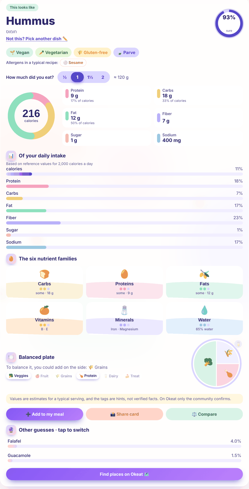
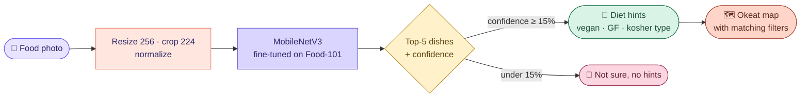

<p align="center">
  <a href="https://noyaadivi.github.io/okeat-lens/"></a>
</p>

<p align="center"><a href="README.he.md"></a></p>

<p align="center">
  <a href="https://noyaadivi.github.io/okeat-lens/"></a>
  <a href="#how-it-works"></a>
  <a href="docs/INTEGRATION.md"></a>
</p>

<p align="center">
  <a href="https://github.com/NoyaAdivi/okeat-lens/actions/workflows/tests.yml"></a>
  <a href="LICENSE"></a>
  <a href="https://github.com/NoyaAdivi/okeat-lens/commits/main"></a>
  <a href="https://github.com/NoyaAdivi/okeat-lens"></a>
</p>

<h3 align="center">Point your camera at a plate. See what's in it and what you can eat.</h3>

<p align="center">
  Okeat Lens is a Computer Vision model that recognizes <b>101 dishes</b> from a single photo<br>
  and turns them into the diet hints <a href="https://okeat.vercel.app">Okeat</a> understands: vegan, vegetarian, gluten-free and kosher type.
</p>

<table align="center">
  <tr>
    <td align="center" width="25%"><a href="#the-model"><b>🍽️ 101</b></a><br><sub>dishes it recognizes</sub></td>
    <td align="center" width="25%"><a href="#the-model"><b>🧠 MobileNetV3</b></a><br><sub>fine-tuned on Food-101</sub></td>
    <td align="center" width="25%"><a href="README.he.md"><b>🌍 HE · EN</b></a><br><sub>every dish named in both</sub></td>
    <td align="center" width="25%"><a href="https://github.com/NoyaAdivi/okeat-lens/actions/workflows/tests.yml"><b>🧪 CI</b></a><br><sub>tests on every push</sub></td>
  </tr>
  <tr valign="top">
    <td valign="top" width="33%">
      <p><b>🍽️ What's in it</b></p>
      <ul>
        <li><b>Calories, protein, carbs, fat</b>, fiber, sugar and sodium</li>
        <li><b>Animated macro donut</b> and % of daily intake</li>
        <li><b>Portion picker</b>: ½, 1, 1½ or 2 servings</li>
      </ul>
    </td>
    <td valign="top" width="33%">
      <p><b>🥚 The six nutrient families</b></p>
      <ul>
        <li><b>Carbs, proteins, fats, vitamins, minerals, water</b></li>
        <li><b>Which vitamins and minerals</b> stand out</li>
        <li><b>Balanced plate</b> view with what to add on the side</li>
      </ul>
    </td>
    <td valign="top" width="33%">
      <p><b>✨ Things no other food app does together</b></p>
      <ul>
        <li><b>9 allergens</b> per dish, next to the kosher type</li>
        <li><b>My meal</b> adds up dishes, <b>compare</b> two dishes</li>
        <li><b>Share card</b> image, recent scans, pick a dish by hand</li>
      </ul>
    </td>
  </tr>
</table>

<a name="highlights"></a>
<p align="center"><a href="#see-it-in-action"></a></p>

<table>
  <tr valign="top">
    <td valign="top" width="33%">
      <p><b>📸 See a dish, name it</b></p>
      <ul>
        <li><b>Transfer learning</b> on 101,000 food photos</li>
        <li><b>Top-5 guesses</b> with a confidence for each</li>
        <li><b>Hebrew and English names</b> for every dish</li>
        <li><b>Knows when it's unsure</b> and says so</li>
      </ul>
    </td>
    <td valign="top" width="33%">
      <p><b>🥗 Turn it into diet hints</b></p>
      <ul>
        <li><b>Vegan, vegetarian, gluten-free</b> per dish</li>
        <li><b>Kosher type:</b> meat, dairy, parve or likely not kosher</li>
        <li><b>Honest by design:</b> hints are never marked as verified</li>
        <li><a href="docs/INTEGRATION.md"><b>Plugs into Okeat</b></a> to open the map with the right filters</li>
      </ul>
    </td>
    <td valign="top" width="33%">
      <p><b>💛 Built to be used</b></p>
      <ul>
        <li><a href="https://noyaadivi.github.io/okeat-lens/"><b>Live web demo</b></a>: drag, drop, paste or snap a photo</li>
        <li><b>REST API</b> with FastAPI and auto docs</li>
        <li><b>ONNX export</b> to run the model anywhere</li>
        <li><b>Tested in CI</b>, no GPU needed for the tests</li>
      </ul>
    </td>
  </tr>
</table>

<a name="see-it-in-action"></a>
<p align="center"><a href="#how-it-works"></a></p>

<p align="center">
  <a href="https://noyaadivi.github.io/okeat-lens/"></a>
</p>

<p align="center">
  <a href="https://noyaadivi.github.io/okeat-lens/"><b>Live demo</b></a> ·
  <a href="#rest-api"><b>API</b></a> ·
  <a href="docs/INTEGRATION.md"><b>Okeat integration</b></a> ·
  <a href="labels.json"><b>All 101 dishes</b></a>
</p>

<a name="how-it-works"></a>
<p align="center"><a href="#the-model"></a></p>



<p align="center"><sub>Diet hints describe a typical recipe. On Okeat only the community can verify a place, so these are always labelled as hints.</sub></p>

<a name="the-model"></a>
<p align="center"><a href="#rest-api"></a></p>

| | |
|---|---|
| **Dataset** | [Food-101](https://data.vision.ee.ethz.ch/cvl/datasets_extra/food-101/): 101 dishes, 750 training and 250 test photos each |
| **Backbone** | [MobileNetV3-Large](https://pytorch.org/vision/stable/models/generated/torchvision.models.mobilenet_v3_large.html), pretrained on ImageNet: small and fast enough for phones |
| **Training** | 1 warm-up epoch with a frozen backbone, then full fine-tuning with AdamW, cosine schedule, label smoothing and mixed precision |
| **Augmentation** | random resized crop, horizontal flip, color jitter |
| **Metrics** | top-1 and top-5 accuracy on the test split, saved to `models/metrics.json` |
| **Browser demo** | [MobileNet in TensorFlow.js](https://github.com/tensorflow/tfjs-models/tree/master/mobilenet), mapped to about 20 foods, so it works with no server |

<details>
<summary><b>🥗 How diet hints are decided</b></summary>
<br>

Every one of the 101 dishes in [`labels.json`](labels.json) has a Hebrew name, an English name, diet tags and a kosher type, based on how the dish is usually made. A few examples:

| Dish | Tags | Kosher type |
|---|---|---|
| 🧆 Falafel · פלאפל | vegan, vegetarian, gluten-free | parve |
| 🍕 Pizza · פיצה | vegetarian | dairy |
| 🥩 Steak · סטייק | gluten-free | meat |
| 🍣 Sushi · סושי | gluten-free | parve |
| 🦐 Shrimp and grits · שרימפס וגריטס | gluten-free | likely not kosher |

The tests check that every vegan dish is also vegetarian, every name exists in both languages and the order matches Food-101.
</details>

<a name="rest-api"></a>
<p align="center"><a href="#tech-stack"></a></p>

| Method | Path | What it does |
|---|---|---|
| `GET` | `/health` | is the server up |
| `GET` | `/labels` | all 101 dishes with names and hints |
| `POST` | `/predict` | send a photo (`file`), get the dish, top-5 and diet hints |
| `GET` | `/nutrition/{key}?portions=1` | calories, macros, the six nutrient families, allergens and % of daily intake |
| `POST` | `/meal` | send `items` (`key`, `portions`), get the meal totals |

```bash
curl -F "file=@hummus.jpg" http://localhost:8000/predict
```

```json
{
  "dish": { "en": "Hummus", "he": "חומוס", "tags": ["vegan", "vegetarian", "gluten_free"], "kosher": "parve", "confidence": 0.93 },
  "hints": { "tags": ["vegan", "vegetarian", "gluten_free"], "kosher": "parve", "verified": false },
  "okeat_url": "https://okeat.vercel.app/map"
}
```

Interactive docs open at `http://localhost:8000/docs`. How Okeat uses this: [docs/INTEGRATION.md](docs/INTEGRATION.md).

<a name="tech-stack"></a>
<p align="center"><a href="#run-locally"></a></p>

<p align="center"><b>Model</b><br>
<a href="https://pytorch.org"></a>
<a href="https://pytorch.org/vision/stable/index.html"></a>
<a href="https://onnx.ai"></a>
</p>

<p align="center"><b>API</b><br>
<a href="https://www.python.org"></a>
<a href="https://fastapi.tiangolo.com"></a>
<a href="https://python-pillow.org"></a>
</p>

<p align="center"><b>Web demo</b><br>
<a href="https://www.tensorflow.org/js"></a>
<a href="https://developer.mozilla.org/docs/Web/JavaScript"></a>
<a href="https://developer.mozilla.org/docs/Web/CSS"></a>
</p>

<p align="center"><b>Ship</b><br>
<a href="https://pages.github.com"></a>
<a href="https://github.com/NoyaAdivi/okeat-lens/actions"></a>
<a href="https://docs.pytest.org"></a>
</p>

<a name="run-locally"></a>
<p align="center"><a href="#contact"></a></p>

1. Install:
   ```bash
   git clone https://github.com/NoyaAdivi/okeat-lens.git
   cd okeat-lens
   pip install -r requirements.txt
   ```
2. Train (Food-101 downloads by itself, about 5 GB):
   ```bash
   python train.py --epochs 1 --subset 0.05   # quick check, a few minutes
   python train.py --epochs 8                 # the real model, best on a GPU
   ```
3. Use it:
   ```bash
   python predict.py my-dinner.jpg            # from the terminal
   uvicorn lens.api:app --reload              # as an API on port 8000
   ```
   Then open `index.html`, pick <b>Food-101 model (API)</b> under ⚙️ and drop a photo.

> [!TIP]
> No GPU? The web demo works right away in the browser, and `python train.py --subset 0.1` trains on 10% of the data.

<details>
<summary><b>📂 Project structure</b></summary>

```
├── lens/
│   ├── diet.py        dish names (HE/EN), diet hints, the JSON Okeat reads
│   ├── predictor.py   loads the model and predicts top-k dishes
│   └── api.py         FastAPI server: /health, /labels, /nutrition, /meal, /predict
├── train.py           fine-tunes MobileNetV3 on Food-101
├── predict.py         recognize a dish from the terminal
├── export_onnx.py     export the model to ONNX
├── labels.json        all 101 dishes with Hebrew names and hints
├── index.html         web demo (GitHub Pages)
├── style.css · app.js pastel theme, animations, in-browser recognition
├── tests/             pytest: labels and API (no GPU needed)
└── docs/
    ├── INTEGRATION.md how Okeat connects to the API
    ├── readme/        animated README banners
    └── images/        screenshots
```
</details>

<a name="contact"></a>
<p align="center"><a href="https://www.linkedin.com/in/noya-adivi/"></a></p>

<p align="center">
  <a href="https://noyaadivi.github.io/okeat-lens/"></a>
  <a href="https://www.linkedin.com/in/noya-adivi/"></a>
  <a href="https://noyaadivi.github.io/noya-website"></a>
  <a href="https://okeat.vercel.app"></a>
  <a href="https://github.com/NoyaAdivi"></a>
</p>
