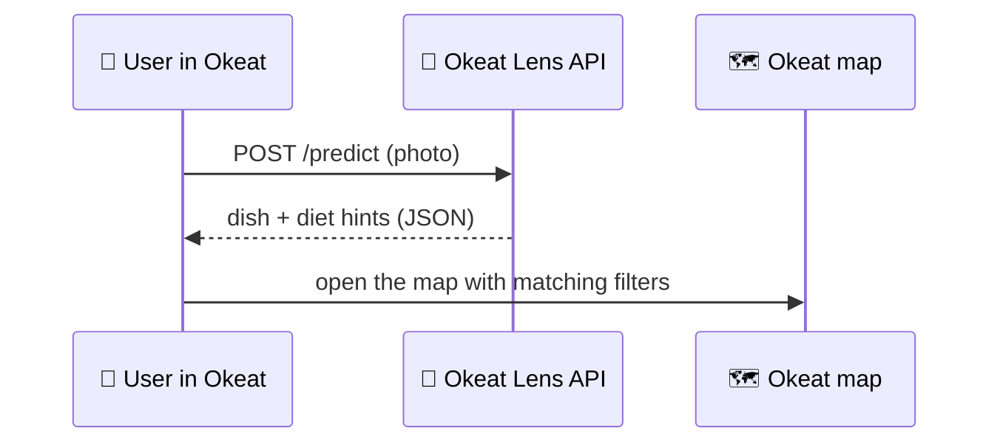

# 🔌 Connecting Okeat Lens to Okeat

Okeat Lens answers one question for [Okeat](https://okeat.vercel.app): *"I'm looking at this dish, where can I eat something like it?"*

## The flow



## What the API returns

`POST /predict` with a `file` field (any image, up to 8 MB). Optional `?k=5` for the number of guesses.

```json
{
  "dish": { "key": "falafel", "en": "Falafel", "he": "פלאפל",
            "tags": ["vegan", "vegetarian", "gluten_free"], "kosher": "parve", "confidence": 0.91 },
  "top": [ "...the same shape, best first..." ],
  "confident": true,
  "hints": { "tags": ["vegan", "vegetarian", "gluten_free"], "kosher": "parve", "verified": false },
  "okeat_url": "https://okeat.vercel.app/map"
}
```

* `dish` is `null` when the best guess is under 15% confidence, and then `hints` is empty.
* `hints.verified` is **always `false`**. These hints come from a typical recipe, so Okeat treats them like its other automatic info: labeled, and never counted as community-verified.

## Turning hints into Okeat filters

| Lens hint | Okeat filter |
|---|---|
| `vegan` | Vegan |
| `vegetarian` | Vegetarian |
| `gluten_free` | Gluten-free |
| `kosher: meat` / `dairy` / `parve` | Kosher, with that kosher type |
| `kosher: not_kosher` | no kosher filter, the dish is shown as is |

## A "Snap a dish" button in Okeat (sketch)

```ts
async function snapDish(file: File) {
  const form = new FormData();
  form.append("file", file);
  const res = await fetch(`${process.env.NEXT_PUBLIC_LENS_URL}/predict`, { method: "POST", body: form });
  const result = await res.json();
  if (!result.confident) return showToast("Not sure what this is, try a closer photo");
  applyFilters({ diet: result.hints.tags, kosherType: result.hints.kosher });
  router.push("/map");
}
```

Set `LENS_ORIGINS=https://okeat.vercel.app` on the API server so only Okeat can call it from a browser.

[⬅ Back to the README](../README.md)
